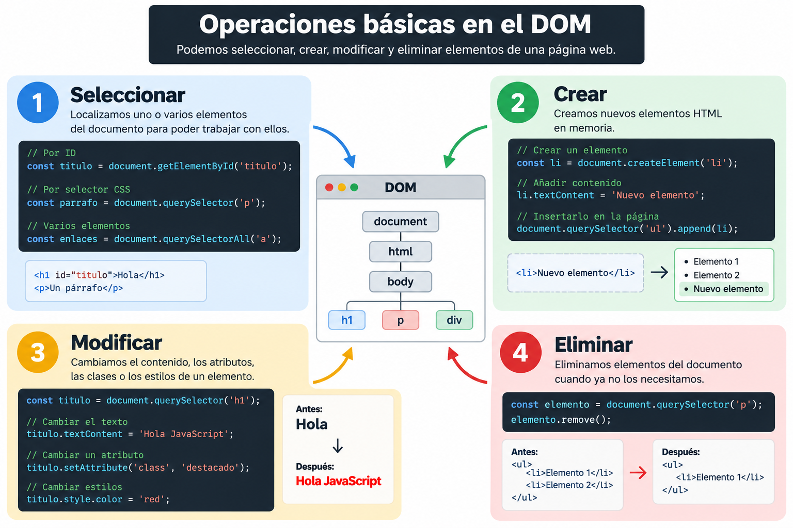

# UD3. Utilización del modelo de objetos del documento (DOM)


Hasta ahora hemos trabajado con JavaScript de forma independiente. A partir de ahora vamos a utilizar JavaScript para **interactuar con las páginas web**.
Para ello utilizaremos el **DOM (Document Object Model)**, que permite acceder a los elementos HTML desde JavaScript, modificarlos, crearlos y responder a las acciones del usuario.



---

## 1. ¿Qué es el DOM?

Cuando el navegador carga una página HTML, no se limita a mostrarla. Construye una representación de la página en forma de **árbol de objetos**.

Este árbol se denomina **DOM (Document Object Model)**.

Por ejemplo, dado este HTML:

```html
<body>
    <h1>Mi página</h1>
    <p>Hola mundo</p>
</body>
```

El navegador crea una estructura similar a:

```text
document
└── html
    └── body
        ├── h1
        │   └── "Mi página"
        └── p
            └── "Hola mundo"
```

Cada elemento HTML se convierte en un **objeto** que JavaScript puede consultar y modificar.

Por eso podemos hacer:

```text
document.querySelector("h1").textContent = "Hola JavaScript";
```

El navegador modificará el contenido del `<h1>`.

---

## 2. El objeto `document`

El objeto `document` representa el **documento HTML actual**.

A través de él podemos acceder a los elementos de la página.

Por ejemplo:

```javascript
console.log(document);
```

El objeto `document` será nuestra principal puerta de entrada al DOM.

---

## 3. Seleccionar elementos

Antes de modificar un elemento necesitamos **localizarlo**. JavaScript proporciona diferentes métodos para hacerlo.

### 3.1. Métodos clásicos

Antes de modificar un elemento del DOM necesitamos **seleccionarlo**. JavaScript dispone de diferentes métodos para localizar elementos HTML.

Los métodos clásicos permiten buscar elementos de diferentes formas:

| Método                     | Selecciona...                    | Ejemplo                                        |
| -------------------------- | -------------------------------- | ---------------------------------------------- |
| `getElementById()`         | Un elemento por su `id`          | `document.getElementById("titulo")`            |
| `getElementsByTagName()`   | Elementos por su etiqueta        | `document.getElementsByTagName("p")`           |
| `getElementsByClassName()` | Elementos por su clase           | `document.getElementsByClassName("destacado")` |
| `getElementsByName()`      | Elementos por su atributo `name` | `document.getElementsByName("nombre")`         |

Por ejemplo:
```html
<!DOCTYPE html>
<html lang="es">

<head>
    <meta charset="UTF-8">
    <title>Selección de elementos DOM</title>
</head>

<body>

    <h1 id="titulo">Alumnos de DAW</h1>

    <p class="destacado">Bienvenidos al curso</p>
    <p>Estamos aprendiendo JavaScript</p>
    <p class="destacado">Hoy estudiamos el DOM</p>

    <nav>
        <a href="#inicio">Inicio</a>
        <a href="#contacto">Contacto</a>
    </nav>

    <input type="text" name="nombre" value="Ana">
    <input type="text" name="apellido" value="García">

    <script src="script.js"></script>

</body>
</html>
```
```javascript
// Seleccionar por ID
const titulo = document.getElementById("titulo"); 
console.log(titulo.textContent); 
// Seleccionar por etiqueta 
const parrafos = document.getElementsByTagName("p"); 
console.log(parrafos.length); 
// Seleccionar por clase 
const destacados = document.getElementsByClassName("destacado"); 
console.log(destacados.length); 
// Seleccionar por atributo name 
const nombres = document.getElementsByName("nombre"); 
console.log(nombres[0].value); 
```

Estos métodos siguen funcionando y es importante conocerlos, pero actualmente utilizaremos principalmente los métodos basados en **selectores CSS**.

---

### 3.2. Selectores CSS


#### 3.2.1 `querySelector()`

Permite seleccionar el **primer elemento** que coincida con un selector CSS.

```javascript
const titulo = document.querySelector("#titulo");
const parrafo = document.querySelector("p");
const destacado = document.querySelector(".destacado");
```

Podemos utilizar prácticamente cualquier selector CSS:

```html
<!DOCTYPE html>
<html lang="es">

<head>
    <meta charset="UTF-8">
    <title>Selección de elementos DOM</title>
</head>

<body>

    <h1 id="titulo">Alumnos de DAW</h1>

    <p class="destacado">Bienvenidos al curso</p>
    <p>Estamos aprendiendo JavaScript</p>
    <p class="destacado">Hoy estudiamos el DOM</p>

    <nav>
        <a href="#inicio">Inicio</a>
        <a href="#contacto">Contacto</a>
    </nav>

    <input type="text" name="nombre" value="Ana">
    <input type="text" name="apellido" value="García">

    <script src="script.js"></script>

</body>
</html>
```
```javascript
document.querySelector("#titulo");        // ID
document.querySelector(".destacado");     // Clase
document.querySelector("p");              // Etiqueta
document.querySelector("div p");          // Descendiente
document.querySelector("input[type='text']"); // Atributo
```

---

#### 3.2.2 `querySelectorAll()`

Funciona como `querySelector()`, pero devuelve **todos los elementos** que coincidan con el selector.

```
const parrafos = document.querySelectorAll("p");
```

Podemos recorrer los elementos obtenidos:

```
parrafos.forEach(parrafo => {
    console.log(parrafo.textContent);
});
```

También podemos utilizar selectores CSS más complejos:

```
const destacados = document.querySelectorAll(".destacado");
const enlaces = document.querySelectorAll("nav a");
const inputs = document.querySelectorAll("input[type='text']"); //Atributo
```

---


## 4. Modificar elementos del DOM

Una vez que hemos seleccionado un elemento, podemos **modificar su contenido, atributos, clases y estilos**.

Por ejemplo:

```
const titulo = document.querySelector("#titulo");
```

A partir de ese momento podemos trabajar directamente con el elemento almacenado en `titulo`.

### 4.1. Propiedades y métodos principales

| Propiedad / método   | ¿Para qué sirve?                            | Ejemplo                                        |
| -------------------- | ------------------------------------------- | ---------------------------------------------- |
| `textContent`        | Cambiar el texto                            | `elemento.textContent = "Hola"`                |
| `innerHTML`          | Cambiar el contenido HTML                   | `elemento.innerHTML = "<strong>Hola</strong>"` |
| `value`              | Obtener o cambiar el valor de un formulario | `input.value = "Ana"`                          |
| `setAttribute()`     | Crear o modificar un atributo               | `img.setAttribute("src", "foto.jpg")`          |
| `getAttribute()`     | Obtener el valor de un atributo             | `img.getAttribute("src")`                      |
| `removeAttribute()`  | Eliminar un atributo                        | `img.removeAttribute("alt")`                   |
| `classList.add()`    | Añadir una clase CSS                        | `elemento.classList.add("activo")`             |
| `classList.remove()` | Eliminar una clase CSS                      | `elemento.classList.remove("activo")`          |
| `classList.toggle()` | Añadir o eliminar una clase                 | `elemento.classList.toggle("activo")`          |
| `style`              | Modificar estilos directamente              | `elemento.style.color = "red"`                 |

---

###  Ejemplo completo


```html
<h1 id="titulo">Título original</h1>

<p id="mensaje">Texto original</p>


<input id="nombre" type="text" value="">

<button id="boton">Modificar</button>
```
```javascript
const titulo = document.querySelector("#titulo");
const mensaje = document.querySelector("#mensaje");
const imagen = document.querySelector("#imagen");
const nombre = document.querySelector("#nombre");

// Cambiar texto
titulo.textContent = "Título modificado";

// Cambiar contenido HTML
mensaje.innerHTML = "<strong>Nuevo mensaje</strong>";

// Cambiar un atributo
imagen.setAttribute("src", "foto2.jpg");

// Cambiar el valor de un formulario
nombre.value = "Ana";

// Modificar una clase
titulo.classList.add("destacado");

// Modificar un estilo
titulo.style.color = "red";
```

De esta forma, JavaScript puede modificar prácticamente cualquier aspecto de los elementos de una página.

---

### 4.2. Modificar contenido:  `textContent` e `innerHTML`

Aunque ambos permiten cambiar el contenido de un elemento, **no funcionan exactamente igual**.

```javascript
elemento.textContent = "<strong>Hola</strong>";
```

Muestra literalmente:

```text
<strong>Hola</strong>
```

Mientras que:

```javascript
elemento.innerHTML = "<strong>Hola</strong>";
```

interpreta la etiqueta HTML y muestra:

**Hola**

Por tanto:

* `textContent` → trata el contenido como **texto**.
* `innerHTML` → interpreta el contenido como **HTML**.

> ⚠️ `innerHTML` debe utilizarse con precaución cuando el contenido procede de usuarios o de fuentes externas puede permitir la inyección de código malicioso (XSS). Cuando solo necesitamos insertar texto, es más seguro utilizar textContent.

---

### 4.3. Modificar clases

Para trabajar con las clases CSS podemos utilizar `classList`:

```
const titulo = document.querySelector("#titulo");

titulo.classList.add("destacado");

titulo.classList.remove("destacado");

titulo.classList.toggle("destacado");

console.log(titulo.classList.contains("destacado"));
```

`toggle()` resulta especialmente útil para crear elementos interactivos, ya que **añade la clase si no existe y la elimina si ya existe**.

---

### 4.4. Modificar estilos

También podemos cambiar directamente los estilos mediante la propiedad `style`:

```
const titulo = document.querySelector("#titulo");

titulo.style.color = "red";
titulo.style.fontSize = "40px";
titulo.style.backgroundColor = "yellow";
```

Sin embargo, cuando los cambios de apariencia son más complejos, suele ser preferible trabajar con **clases CSS**:

```
titulo.classList.add("destacado");
```

en lugar de modificar muchos estilos individualmente.


## 5. Crear elementos

JavaScript también permite crear nuevos elementos HTML.

Por ejemplo:

```
const parrafo = document.createElement("p");

parrafo.textContent = "Este párrafo ha sido creado con JavaScript";
```

En este momento el elemento existe en memoria, pero todavía no aparece en la página.

Para añadirlo:

```
document.body.append(parrafo);
```

También podemos añadirlo dentro de otro elemento:

```html
<div id="contenedor"></div>
```

```javascript
const contenedor = document.querySelector("#contenedor");

const parrafo = document.createElement("p");

parrafo.textContent = "Nuevo párrafo";

contenedor.append(parrafo);
```

---

## 6. Eliminar elementos

Podemos eliminar un elemento utilizando `remove()`.

```
const parrafo = document.querySelector("p");

parrafo.remove();
```

---

## 7. Eventos

Hasta ahora hemos ejecutado JavaScript directamente, pero una página web debe poder **reaccionar a las acciones del usuario**.

Un **evento** es algo que sucede en la página:

* El usuario hace clic.
* Escribe en un campo.
* Envía un formulario.
* Pulsa una tecla.
* Mueve el ratón.
* Cambia el valor de un elemento.

Para reaccionar/capturar estos eventos utilizamos `addEventListener()`.

```html
<button id="boton">Pulsar</button>
```
```javascript
const boton = document.querySelector("#boton");

boton.addEventListener("click", () => {
    console.log("Has pulsado el botón");
});
```

La función se ejecutará cada vez que se produzca el evento `click`.


!!! note "Información"
    `() => {} ` fíjate que es lo mismo que una función anónina: `function() { }`.


---

## 7.1. El objeto `event`

Cuando ocurre un evento, JavaScript proporciona información sobre él mediante un objeto.

```
boton.addEventListener("click", event => {
    console.log(event);
});
```

Por ejemplo, podemos saber qué elemento ha provocado el evento:

```
boton.addEventListener("click", event => {
    console.log(event.target);
});
```

`event.target` representa el elemento sobre el que se produjo el evento.

!!! note "Información"
    `event => {}` fíjate que es lo mismo que una función anónina con un argumento: `function(event) { }`.

---

## 7.2. Eventos habituales

| Evento      | Se produce cuando...             |
| ----------- | -------------------------------- |
| `click`     | Se hace clic                     |
| `dblclick`  | Se hace doble clic               |
| `input`     | Cambia el contenido de un campo  |
| `change`    | Cambia el valor de un elemento   |
| `submit`    | Se envía un formulario           |
| `keydown`   | Se pulsa una tecla               |
| `keyup`     | Se suelta una tecla              |
| `mouseover` | El ratón entra sobre un elemento |
| `mouseout`  | El ratón sale de un elemento     |

Por ejemplo:

```
const campo = document.querySelector("#nombre");

campo.addEventListener("input", () => {
    console.log(campo.value);
});
```

Cada vez que el usuario escriba, podremos obtener el contenido actual del campo.

---

## 8. Formularios

Los eventos permiten controlar los formularios antes de enviarlos.

```html
<form id="formulario">
    <input id="nombre" type="text">
    <button>Enviar</button>
</form>
```

```javascript
const formulario = document.querySelector("#formulario");

formulario.addEventListener("submit", event => {

    event.preventDefault();

    const nombre = document.querySelector("#nombre").value;

    console.log(`Hola ${nombre}`);
});
```

### 8.1. `preventDefault()`

Por defecto, un formulario intenta enviarse al servidor.

Con `event.preventDefault();` evitamos ese comportamiento.

Esto nos permite controlar el formulario completamente desde JavaScript.

---

### 8.2. Ejemplo completo de formulario

Vamos a combinar varias de las técnicas anteriores.

```html
<form id="formulario">

    <h2>Crear cuenta</h2>

    <label>
        Nombre:
        <input type="text" id="nombre">
    </label>

    <label>
        Email:
        <input type="email" id="email">
    </label>

    <label>
        Edad:
        <input type="number" id="edad">
    </label>

    <label>
        Contraseña:
        <input type="password" id="password">
    </label>

    <label>
        Repetir contraseña:
        <input type="password" id="password2">
    </label>

    <label>
        <input type="checkbox" id="condiciones">
        Acepto las condiciones
    </label>

    <button type="submit">Registrarse</button>

    <p id="mensaje"></p>

</form>
```
```javascript
const formulario = document.querySelector("#formulario");

const nombre = document.querySelector("#nombre");
const email = document.querySelector("#email");
const edad = document.querySelector("#edad");
const password = document.querySelector("#password");
const password2 = document.querySelector("#password2");
const condiciones = document.querySelector("#condiciones");

const mensaje = document.querySelector("#mensaje");

formulario.addEventListener("submit", event => {

    event.preventDefault();

    if (nombre.value.trim() === "") {
        mensaje.textContent = "Introduce tu nombre.";
        return;
    }

    const formatoEmail = /^[^\s@]+@[^\s@]+\.[^\s@]+$/;

    if (!formatoEmail.test(email.value)) {
        mensaje.textContent = "Introduce un email válido.";
        return;
    }

    if (edad.value < 18) {
        mensaje.textContent = "Debes tener al menos 18 años.";
        return;
    }

    if (password.value !== password2.value) {
        mensaje.textContent = "Las contraseñas no coinciden.";
        return;
    }

    if (!condiciones.checked) {
        mensaje.textContent = "Debes aceptar las condiciones.";
        return;
    }

    mensaje.textContent = "Registro realizado correctamente.";
});
```


## 9. Resumen

El DOM permite a JavaScript interactuar con los elementos de una página HTML.

Las operaciones fundamentales son:

| Operación                         | Método o propiedad   |
| --------------------------------- | -------------------- |
| Seleccionar por ID                | `getElementById()`   |
| Seleccionar mediante CSS          | `querySelector()`    |
| Seleccionar varios                | `querySelectorAll()` |
| Modificar texto                   | `textContent`        |
| Modificar HTML                    | `innerHTML`          |
| Obtener valor de formulario       | `value`              |
| Modificar atributos               | `setAttribute()`     |
| Consultar atributos               | `getAttribute()`     |
| Trabajar con clases               | `classList`          |
| Crear elementos                   | `createElement()`    |
| Añadir elementos                  | `append()`           |
| Eliminar elementos                | `remove()`           |
| Escuchar eventos                  | `addEventListener()` |
| Evitar comportamiento por defecto | `preventDefault()`   |

La idea fundamental es:

```text
HTML
 ↓
DOM
 ↓
JavaScript
 ↓
Modificar la página
 ↓
Responder a las acciones del usuario
```