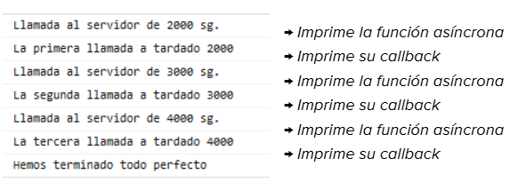
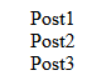

---

# Ejercicios prácticos

## CALLBACKS

??? question "📝 Ejercicio 1: Simular una consulta a una base de datos"

Implementa una función buscarUsuario que simule la consulta de un usuario en una base de datos. Debes utilizar callbacks para representar una operación que tarda un tiempo indeterminado en completarse.

La función debe:
- Recibir un identificador.
- Recibir un callback.
- Simular una espera de dos segundos.
- Devolver los datos del usuario mediante el callback.

Este es el código inicial del ejercicio:

```javascript
const usuarios = [
    { id: 1, nombre: "Ana" },
    { id: 2, nombre: "Luis" },
    { id: 3, nombre: "Marta" }
];

function buscarUsuario(id, callback) {
    // 1. Simular la consulta con setTimeout.

    // 2. Buscar el usuario cuyo id coincida.

    // 3. Invocar el callback con el resultado.
}

buscarUsuario(2, (usuario) => {
    console.log("Usuario encontrado:", usuario);
});
```

??? question "📝 Ejercicio 2: Controlando errores en la consulta a una base de datos"

Sobre el ejercicio anterior terminado, debes de implementar una solución que sea capaz de controlar errores cumpliendo los siguientes criterios:

- Añadir un callback de error.
- Buscar un usuario que no exista Mostrar un mensaje cuando la búsqueda no tenga resultados.

Resumiendo, debes ser capaz de simular diferentes tipos de respuesta, tanto si se encuentra como si no el elmento buscado en la consulta de la base de datos. Para ello debes de modificar el método que se usa como callback, para que este sea capaz de recibir dos argumenots, uno para cuando se produzca algún error, y otro para cuando no y se devuelva un valor solicitado. 


??? question "📝 Ejercicio 3: Realizando diversas llamadas"

A partir de una página html simple y de obtener mensajes a través de la consola, vamos a tratar de controlar mediante el uso de “callback”  3 llamadas “anidadas” a una función la cual simulará una llamada a un servidor. Esta simulación será simplemente un “setTimeout()” con X segundos de retraso. La primera llamada tardará 2 segundos en terminar de ejecutarse, la segunda 3 segundos y la tercera llamada 4 segundos.   

**NOTA:** La segunda llamada a la función “pesada” debe esperar a que la primera llamada a dicha función termine. Suponemos que la segunda, depende del resultado de la primera (y así con el resto) (Suponemos). De eso se trata el anidamiento.

La función “callback” deberá NO ser anónima, y además deberá de tener 2 parámetros: uno para el objeto Error, y otro con el valor que trae desde su llamada (vamos a devolver el tiempo de espera, por ejemplo).


``` javascript
function llamadaServidor( numSegundos , callback)
{
  setTimeout( function() { console.log(`Llamada al servidor de ${numSegundos} sg.`); }, numSegundos );
}
```

- Resultado Final:  La salida del script debe de ir perfecta, sin fallos. Debe de obtener una salida similar a la siguiente:




## PROMESAS

??? question "📝 Ejercicio 4: Básico de creación de promesas"

Crea una promesa que se resuelva correctamente después de 2 segundos. La promesa debe devolver el mensaje:

*"¡Hola! La operación ha terminado correctamente."*

Consume la promesa utilizando .then() y muestra el mensaje recibido por consola. 

Código inicial:

```javascript
const miPromesa = new Promise((resolve, reject) => {

    // Completar

});

// Completar consumir la promesa:

```

??? question "📝 Ejercicio 5: Básico de creación de promesas"


Crea una función llamada **comprobarEdad** que reciba una edad y devuelva una promesa.

La promesa debe comportarse de la siguiente manera:
- Si la edad es igual o superior a 18, se resuelve con el mensaje "Acceso permitido".
- Si la edad es inferior a 18, se rechaza con el mensaje "Acceso denegado".
Consume la promesa utilizando .then() y .catch().

Ejemplo de cómo debe usarse la promesa:
```javascript
    comprobarEdad(20)
    .then(resultado => {
        console.log(resultado);
    })
    .catch(error => {
        console.error(error);
    });
```

??? question "📝 Ejercicio 6: Intermedio de creación de promesas - simulando llamada a servidor"

Implementa una función obtenerUsuario que simule una consulta a un servidor.

La función debe:
- Recibir un identificador de usuario.
- Devolver una promesa.
- Simular una espera de 2 segundos.
- Si el identificador es válido (mayor que cero), resolver la promesa con los datos del usuario.
- Si el identificador no es válido, rechazar la promesa.

- Datos simulados traídos del servidor:
```javascript
{
    id: 1,
    nombre: "Ana",
    email: "ana@ejemplo.com"
}
```

Código de partida:
```javascript
function obtenerUsuario(id) {

    return new Promise((resolve, reject) => {

        setTimeout(() => {

            // Completar

        }, 2000);

    });

}
```

Ejemplo de cómo debería poder usarse
```javascript
obtenerUsuario(1)
    .then(usuario => {
        console.log("Usuario recibido:", usuario);
    })
    .catch(error => {
        console.error(error);
    })
    .finally(() => {
        console.log("Consulta finalizada");
    });
```

??? question "📝 Ejercicio 7: Avanzado de creación de promesas - encadenando promesas"


Implementa dos funciones:
- obtenerNumero(): devuelve una promesa que se resuelve con el número 10 después de un segundo.
- duplicarNumero(numero): devuelve una promesa que se resuelve con el doble del número recibido después de otro segundo.
Encadena ambas operaciones para obtener el resultado final.

Código de partida:
```javascript
function obtenerNumero() {

    return new Promise((resolve) => {

        setTimeout(() => {
            resolve(10);
        }, 1000);

    });

}

function duplicarNumero(numero) {

    return new Promise((resolve) => {

        setTimeout(() => {
            resolve(numero * 2);
        }, 1000);

    });

}
```

Debes de anidar promesas y escribir el código que sea capaz de darnos esta salida:
```
Número inicial: 10
Número duplicado: 20
```


??? question "📝 Ejercicio 8: De callbacks a promesas: consulta de un usuario

A partir del código asíncrono realizado con callbacks, transformalo para que se realice la misma operación y resultado pero con Promesas.

Código original con callbacks
```javascript
function obtenerUsuario(id, callback) {

    console.log("Consultando usuario...");

    setTimeout(() => {

        if (id > 0) {

            const usuario = {
                id: id,
                nombre: "Ana",
                email: "ana@ejemplo.com"
            };

            callback(null, usuario);

        } else {

            callback("Identificador incorrecto", null);

        }

    }, 2000);

}


// Llamada a la función

obtenerUsuario(1, (error, usuario) => {

    if (error) {
        console.error("Error:", error);
        return;
    }

    console.log("Usuario encontrado:");
    console.log(usuario);

});
```

??? question "📝 Ejercicio 9: De callbacks a promesas: proceso de compra

Este es el ejercicio más complejo de todos ya que no solo tienes que convertir código resulto con callbacks a código resuelto con promesas, sino que si te fijas bien, el código original realizado con callbacks es anidado, es decir, una vez se llama a un callback cuando finaliza, se llama a otro, y sucesivamente. Lo mismo debemos implementarlo con promesas y encadenando ".then". 

Ánimo, si consigues realizar este ejercicio estás más que preparado.

```
Una tienda online necesita realizar tres operaciones para completar una compra:
1. Obtener los datos del usuario.
2. Consultar su carrito de compra.
3. Procesar el pedido.
Actualmente, el programa utiliza callbacks para coordinar estas operaciones.

Tu misión consiste en transformar las tres funciones para que devuelvan promesas y reescribir el código principal utilizando el encadenamiento de .then().
```

```javascript
function obtenerUsuario(id, callback) {

    console.log("Buscando usuario...");

    setTimeout(() => {

        if (id > 0) {

            callback(null, {
                id: id,
                nombre: "Carlos"
            });

        } else {

            callback("Usuario no encontrado", null);

        }

    }, 1000);

}


function obtenerCarrito(usuario, callback) {

    console.log("Consultando carrito...");

    setTimeout(() => {

        const carrito = {
            usuario: usuario.nombre,
            productos: ["Teclado", "Ratón"],
            total: 50
        };

        callback(null, carrito);

    }, 1500);

}


function procesarPedido(carrito, callback) {

    console.log("Procesando pedido...");

    setTimeout(() => {

        if (carrito.total > 0) {

            callback(null, {
                productos: carrito.productos,
                importe: carrito.total,
                estado: "Confirmado"
            });

        } else {

            callback("No se puede procesar el pedido", null);

        }

    }, 2000);

}


// PROGRAMA PRINCIPAL

obtenerUsuario(1, (error, usuario) => {

    if (error) {
        console.error(error);
        return;
    }

    obtenerCarrito(usuario, (error, carrito) => {

        if (error) {
            console.error(error);
            return;
        }

        procesarPedido(carrito, (error, pedido) => {

            if (error) {
                console.error(error);
                return;
            }

            console.log("Pedido realizado correctamente:");
            console.log(pedido);

        });

    });

});
```


## ASYNC/AWAIT

??? question "📝 Ejercicio 10: De promesas a callbacks

Disponemos de una función llamada obtenerMensaje() que devuelve una promesa que se resuelve después de dos segundos con el mensaje "Hola, alumno".

```javascript
function obtenerMensaje() {

    return new Promise(resolve => {

        setTimeout(() => {
            resolve("Hola, alumno");
        }, 2000);

    });

}
```
Debes de realizar las siguientes tareas:

1. Crea una función asíncrona llamada mostrarMensaje().
2. Utiliza await para esperar a que termine la promesa devuelta por obtenerMensaje().
3. Guarda el resultado en una variable llamada mensaje.
4. Muestra el contenido de mensaje por consola.
5. Añade un mensaje al principio y otro al final de la función para comprobar el orden de ejecución.


??? question "📝 Ejercicio 10: Cuenta atrás asíncrona


Crea una función llamada **esperar(segundos)** que devuelva una promesa que se resuelva después del número de segundos indicado.
A continuación, crea una función asíncrona llamada **cuentaAtras()** que realice una cuenta atrás desde 5 hasta 1.
Entre cada número deberá esperar un segundo.

El resultado debe ser parecido a este:
```
5
4
3
2
1
¡Despegamos!
```
Podrías empezar a realizar el ejercicio usando esta función base:

```javascript
function esperar(segundos) {

    return new Promise(resolve => {

        setTimeout(() => {
            resolve();
        }, segundos * 1000);

    });
```


??? question "📝 Ejercicio 11: De promesas a callbacks

Convierta las siguientes líneas de código haciendo uso de **async/await** en vez de **.then/catch**:

- Para resolver este ejercicio hay que tener en cuenta que el método “fetch” el cual se utiliza para hacer llamadas HTTP a un servidor, e internamente, cuando se finaliza, devuelve una promesa.
- Para probarlo bien, podéis fabricar un archivo  nombre.json con contenido Json y cargarlo desde local. O también podéis llamar a un servidor gratis que sirva información JSON como puede ser “https://httpbin.org/json”.
- Si hubiera algún error en el código, arreglarlo antes de hacer la modificación. 


```javascript

function loadJson(url) {
  return fetch(url)
	.then(response => {
  	if (response.status == 200) {
    	   return response.json();
  	} else {
    	   throw new Error(response.status);
  	}
	})
}

loadJson('no-such-user.json') // (3)
  .catch(alert); // Error: 404

```

??? question "📝 Ejercicio 12: EJERCICIO FINAL

Partiendo del siguiente código: 

```javascript
const posts = [
    {title: "Post1", body: "This is post one"},
    {title: "Post2", body: "This is post two"}
];

function getPosts(){
    setTimeout(()=> 
    {
        let output =``;
        posts.forEach( (post, index) => {
            output += `<li>${post.title}</li>`;
        })
        document.body.innerHTML = output;
    }
    , 1000);
}

function createPost (newPost) {
    setTimeout( () => { posts.push(newPost) } , 2000);
}

getPosts();
createPost({title: "Post3", body: "This is post three"});
```

Vamos a resolver el problema que podrá usted observar; el problemilla es que el método “createPost” tarda 2 segundos en ejecutarse, y el “getPosts” tarda un segundo, y da igual el orden en el que llames a los dos métodos que el tercer post que debe mostrarse nunca se muestra. El resultado final debe de ser así:

Ejercicio 12.1:  Busque una solución al problema haciendo uso de callbacks.
Ejercicio 12.2:  Busque una solución al problema haciendo uso de promises.
Ejercicio 12.3:  Busque una solución al problema haciendo uso de async/await.

Resultado esperado:


