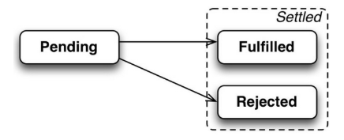
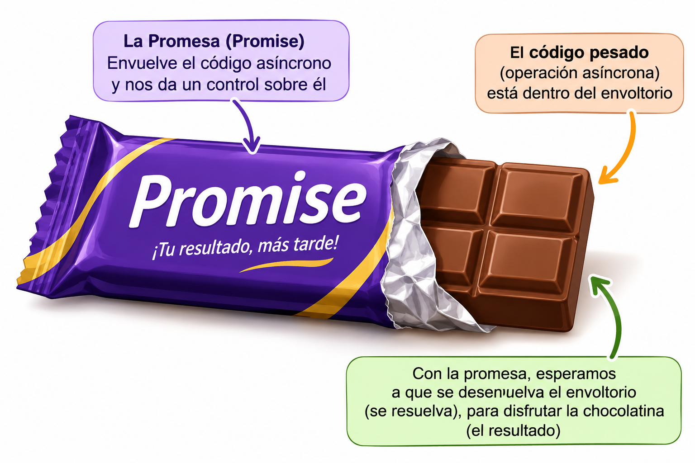
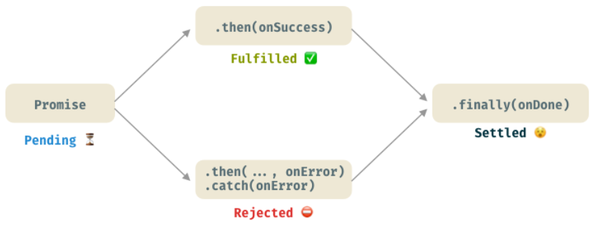
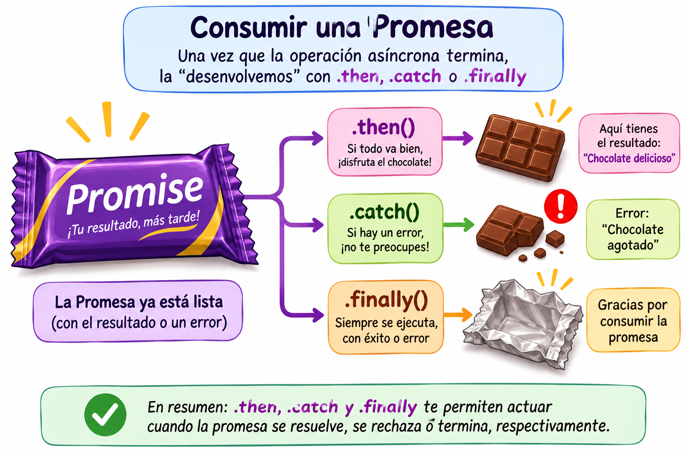

# UD4. Asincronía en Javascript.

## 1. Introducción a la asincronía

### 1.1. Ejecución síncrona y asíncrona

JavaScript ejecuta normalmente las instrucciones de un programa de forma secuencial: una instrucción comienza después de que haya terminado la anterior. Este comportamiento se denomina ejecución síncrona.

Sin embargo, algunas operaciones pueden tardar cierto tiempo en completarse, como consultar una API, descargar información de un servidor o esperar un temporizador. Si JavaScript tuviera que detener la ejecución del programa hasta que cada una de estas operaciones terminara, la aplicación podría quedarse bloqueada.

Para evitarlo, JavaScript dispone de mecanismos que permiten gestionar estas operaciones de **forma asíncrona**, continuando con otras tareas mientras espera sus resultados.

### 1.2. Soluciones para asincronía

En javascript principalmente existen 3 técnicas basadas para la asincronía:
1. Callbacks
2. Promises
3. Async/Await

Generalmente son usados en todas aquellas funciones que conlleven cierto tiempo de ejecución y no queremos bloquear el programa como pueden ser:

- Acceso a ficheros. 
- Operaciones de red.
- Acceso a bases de datos.
- Carga de imágenes pesadas.
- Operaciones matemáticas complejas.
- Etc.

!!! note "Información"
    En estos apuntes y ejercicios relacionados simularemos **tareas pesadas** haciendo uso de **setTimeout()**.

## 2. Callbacks
Los callbacks es una técnica que se utiliza en muchos lenguajes de programación, y podemos definirlos como:

!!! Definición 

    **Función callback:** Son funciones que se pasan como parámetros de otras funciones y que se “llaman” dentro de estas cuando una determinada operación ha terminado.


```html
<!DOCTYPE html>
<html lang="es">
<head>
    <meta charset="UTF-8">
</head>
<body>
</body>
</html>
```
```javascript

    function procesarDatos(callback) 
    {
        console.log("Procesando datos...");
        console.log("Inicio");

        setTimeout(() => {
            let datoProcesado = 666;  //Simulo un dato que ha tardado en obtenerse.
            console.log("Ya hemos terminado, y llamo al callback");
            callback(datoProcesado);  //El callback puede (o no) recivir valores 
                                      //como argumento.
        }, 2000);
    }

    function callback(resultado)
    {
        console.log(`Este es el resultado obtenido: ${resultado}`)
    }

    procesarDatos(callback);
    
```

## 2.1. Manejo de errores con callbacks (Handling errors)

Los callbacks no siempre devuelve un resultado correcto, también se pueden devolver errores. Es por esto que se suelen construir los métodos callbacks con 2 argumentos, el primero para cuando se devuelva el valor correcto, y el segundo cuando se tenga que devolver un error. Procedamos a modificar el ejemplo anterior para contemplar posibles errores (el error será simulado):

```html
<!DOCTYPE html>
<html lang="es">
<head>
    <meta charset="UTF-8">
</head>
<body>
</body>
</html>
```
```javascript

    function procesarDatos(callback) 
    {
        console.log("Procesando datos...");
        console.log("Inicio");

        setTimeout(() => {
            let datoProcesado = 666;  //Simulo un dato que ha tardado en obtenerse.
            console.log("Ya hemos terminado, y llamo al callback");

            //Simulamos que se ha producido un error!! Sus valores son inventados 
            let error = new Error();
            error.name = "401"
            error.messae = "Sitio no encontrado"
            callback(-1 , error);  //El callback puede (o no) recivir valores 
                                   //como argumento.
        }, 2000);
    }

    function callback(resultado, error)
    {

        if(!error)
            console.log(`Este es el resultado obtenido: ${resultado}`);
        else
            console.log(`Se ha producido un error: ${error.name} y mensaje: ${error.message}`);
    }

    procesarDatos(callback);
    
```

!!! warning "Importante"

    EJERCICIO INTRODUCTORIO : Complementa el siguiente código de forma que se imprima por consola la salida: “1  2  3”.

    

    ``` javascript
    function useCallback(callback)
    {
        callback(1);
        callback(2);
        callback(3);
    }

    function callback(sentence) {
    }
    ```
    

!!! tip "Consejo"

    Existe infinidad de tutoriales externos donde aprender más o mejor los callbacks:

    -  [Programación Asíncrona: callbacks](https://www.aprendejavascript.dev/clase/programacion-asincrona/callbacks)
    -  [Callbacks en JavaScript: funciones para asincronía](https://www.luisllamas.es/javascript-callbacks/)


## 3. Promesas

Las “promesas” son una nueva técnica que apareció para sustituir, en teoría, el uso de callbacks. Hace que el código sea menos engorroso, sobretodo a la hora de anidamiento de operaciones asíncronas.
Si estuviéramos en el contexto de la película “Regreso al futuro” las podríamos definir como: 

!!! Definición 

    **Promesas:** Una promesa es un objeto que representa el valor de una operación que será resuelta en el futuro.

Promises nos permiten esperar a que un determinado código termine su ejecución, antes de ejecutar la próxima sección de código. Su comportamiento es parecido al de los “callbacks”.

### 3.1. ¿Por qué es importante?

Porque nos ayudan a manejar operaciones asíncronas y esperar a que terminen y hacer algo (o no) cuando terminen. Un ejemplo muy claro de uso puede ser cuando nos traemos “datos” de un servidor. Normalmente tarda un poco en traer los datos, y ¿vamos a bloquear la web hasta que lleguen? ¿y si no llegan xq el servidor se ha caído?; estas situaciones “asíncronas” las manejaremos como tal, y debemos prever una respuesta tanto si todo funciona bien como si no.

### 3.2. ¿Qué es una Promise?

En Javascript,  **Promise** representa el resultado generado tras una operación asíncrona. Podemos hacer el símil de que Promise es como un “recipiente o envase” el cual es “adherido” (attached) a la respuesta o al resultado tras completarse una operación asíncrona.

**Promise** puede tener/estar en 1 de estos 3 estados:

- **Pending**   → La operación asíncrona no ha sido completada aún.
- **Fulfilled**  (Resolved) →  La operación asíncrona se ha completado y Promise ya tiene un valor.
- **Rejected**  → La operación se ha completado con un error o fallo.

De estos 3 estados se dice que si la promesa aún no está resuelta está en estado “Pending” y si ha sido terminada pues estará o “Fulfilled” o “Rejected”. Una vez finaliza automáticamente se le llama “Settled”.




### 3.3. Trabajando con Promises.
La sintaxis básica de una promesa es la siguiente:
```javascript
//ES5       
new Promise( /* Ejecutor */ function(resolver, rechazar) { ... } );
//ES6
new Promise( /* Ejecutor */ (resolver, rechazar) => { ... } );
```

!!! warning "Importante"
    Resolver y rechazar (en inglés “resolve” y “reject”) son funciones “callbacks especiales”. Cuando invocamos la función “resolve” se dispara el consumidor “.then”  y cuando invocamos la función “reject” se dispara la función consumidora “.catch”. 

A la hora de trabajar con promesas podemos discernis entre 2 fases:
- Fase de creación.
- Fase de consumo. 

### 3.3.1 Fase de creación

En la fase de creación debemos de **"memorizar"** el código que crea la promesa y crea el envoltorio del código pesado, es decir, el código que va a bloquear la web porque necesita tiempo para ejecutarse y debemos ejecutarlo de forma asíncrona (no bloqueante).



Existen comúnmente 2 formas de crear una promesa. En el futuro podréis encontraros con ambas versiones.

**Opción 1:** La forma estándar de crear promesas es a través de su constructor y asignándola a una variable:


```javascript
let miPrimeraPromise = new Promise( (resolve, reject) => {
  // Llamamos a resolve(...) cuando lo que estábamos haciendo finaliza con éxito, y reject(...) cuando falla.
  // En este ejemplo, usamos setTimeout(...) para simular código asíncrono.
  setTimeout(function(){
	resolve("¡Éxito!"); // ¡Todo salió bien!
  }, 2000);

   setTimeout(function(){
	reject("¡Tristeza!"); // ¡Todo salió bien!
  }, 2000);

});


// Y ahora consumimos la promesa: 
miPrimeraPromise.then( (successMessage) => {
  // succesMessage es lo que sea que pasamos en la función resolve(...) de arriba.
  // No tiene por qué ser un string, pero si solo es un mensaje de éxito, probablemente lo sea.
  console.log("¡Sí! " + successMessage);
});
```


**Opción 2:**  La segunda forma de crearlas es haciendo uso de una función contenedora. La principal ventaja es que se nos facilita el poder usar parámetros/argumentos dentro de la promesa:

```javascript
function delay(t) 
{
  return new Promise( function(resolve, reject) {
      //Código que quieres que se ejecute asíncronamente, por ejemplo:
	 setTimeout(() => resolve(“Hemos terminado bien”), t );  // → Simulamos algo q tarda “t” segundos y se llamará al callback “resolve” al terminar.
  });
}

// Y ahora consumimos la promesa:
// delay(4000).then( texto => console.log(texto));

```

### 3.3.2 Fase de consumo

Los consumidores dentro del contexto de promesas son los métodos **“then”, “catch” y “finally”**. Una cosa importante a resaltar es que estos métodos, a la vez que consumen promesas, también retornan promesas, dando la posibilidad de **encadenar promesas**.




#### 3.3.2.1.   then:   
Sin duda este es el más importante y será ejecutado cuando. Tiene 2 argumentos:

```javascript
promise.then(
  function(result) { /* Maneja un resultado satisfactorio */ }  , 
  function(error)  { /* Maneja un error */ }
);
```

**→ Primer argumento:**  El primer argumento se invoca cuando la promesa es “fullfilled” positivamente (resolved), y recibe el resultado.

**→ Segundo argumento:** El segundo argumento se invoca cuando la promesa es “fullfilled” incorrectamente (rejected).
Ejemplo:  partiendo de la siguiente promesa (creada por su constructor) vamos a ver los dos casos: resolved y rejected.

Un ejemplo:

```javascript
let promise = new Promise(function(resolve, reject) {
  setTimeout(() => resolve("done!"), 1000);
});
//Ejecutamos el .then como “resolve”
promise.then(
  result => alert(result) , //Muestra "done!" después de 1 segundo.
  error => alert(error) // No se ejecuta
);
```

#### 3.3.2.1. catch:   
 
Catch es uno de los consumidores de promesas que serán llamados cuando un error ha ocurrido. Si todo va bien, nunca será ejecutado. Veamos un ejemplo en el que se encadenan varias promesas:

```javascript
const promesa = new Promise((resolve, reject) => {
  const exito = false; // cambia a true para probar el caso correcto

  if (exito) {
    resolve("✅ Todo salió bien");
  } else {
    reject("❌ Algo salió mal");
  }
});

// Consumimos la promesa
promesa
  .then(resultado => {
    console.log("Resultado:", resultado);
  })
  .catch(error => {
    console.error("Error capturado con catch:", error);
  });
```

#### 3.3.2.1. finally:

Finally será invocado siempre que la promesa llegue a estado “settled”, es decir, terminada. 

```javascript
new Promise((resolve, reject) => {
  /* do something that takes time, and then call resolve/reject */
})
  // runs when the promise is settled, doesn't matter successfully or not
    .then(result => show result, err => show error)
    .finally(() => stop loading indicator)

``` 





### 3.2 Encadenando Promesas

Uno de los puntos fuertes de las promesas frente a los callbacks es la capacidad de simplificar la encadenación de acciones asíncronas sin tener que anidar. Veamos el siguiente ejemplo:

```javascript
new Promise(function(resolve, reject) {
  	setTimeout(() => resolve(1), 1000); // (*)
}).then( function(result) { // (**)
  	alert(result); // 1
  	return result * 2;
})).then(function(result) { // (***)
  	alert(result); // 2
  	return result * 2;
}).then(function(result) {
  	alert(result); // 4
  	return result * 2;
});
```

**Importante:**  La cadena de promesas funciona correctamente porque cada llamada a “promise.then” devuelve una promesa:  Cada promesa devuelta por cada “.then” retroalimenta a la entrada del siguiente “.then”. 


!!! tip "Consejo"

    Existe infinidad de tutoriales externos donde aprender más o mejor las Promesas:

    -  [Promises (Promesas) - Básico](https://www.aprendejavascript.dev/clase/programacion-asincrona/promises-basico)
    -  [Promesas en JavaScript para operaciones asíncronas](https://www.luisllamas.es/javascript-promesas/)


## 2. Async / Await


Podemos decir que async/await es la 3ª propuesta de javascript para código asíncrono. Realmente está basado en promesas, y no es más que una sintaxis nueva (una nueva forma de escribir código de promesas) que nació con el próposito de facilitar el "anidamiento" de promesas. En vez de usar tanto .then y .catch cuando se hay que realizar varias tareas asíncronas, veremos que con async/await se queda un código muy "coqueto" y simple. 

El async/await siempre siempre siempre viene asociado a una función asíncrona. Procesamos a explicarla:

### 2.1. Función async/await

No es más que una función en la que en su cuerpo (body) se van a realizar tareas pesadas sobre las que vamos a aplicar asincronía. La sintaxis es precederlas siempre de la palabra "async".

```javascript
async function funcionAsincrona() {   
  return 1;       //Equivale a:   return Promise.resolve(1);
}

funcionAsincrona().then(alert); // 1
```

**IMPORTANTE** Toda función async devuelve una promesa. ¿Qué supone esto? Que cuando la llamemos para usarla debemos de usar .then, .catch y/o .finally.

### 2.2 Await

**await** es una palabra reservada de JavaScript que permite esperar a que una operación asíncrona termine antes de continuar ejecutando las siguientes instrucciones de una función.

Se utiliza habitualmente delante de una promesa. Cuando JavaScript encuentra un await, suspende la ejecución de la función async en ese punto hasta que la promesa se resuelve o se rechaza.

- Si la promesa se resuelve (fulfilled), await devuelve el valor obtenido y continúa ejecutando las siguientes instrucciones.
- Si la promesa se rechaza (rejected), await lanza una excepción que puede capturarse mediante un bloque try...catch.

!!! warning "Importante"

    1. En el contexto habitual de una aplicación JavaScript, await solo puede utilizarse dentro de funciones declaradas con async. Existe una excepción: también puede utilizarse directamente en módulos JavaScript mediante top-level await.
    2. await no bloquea la ejecución del programa. Únicamente suspende la ejecución de la función asíncrona que lo contiene mientras espera el resultado.

Veamos un ejemplo:

```javascript
async function probando() 
{
    let promise = new Promise((resolve, reject) => {
        setTimeout(() => reject("BAD DONE!"), 1000);  
    });

    try{
        let result = await promise; // espera hasta que la promesa se resuelva
    }
    catch(error)
    {
        return error;
    }
    return result; // "done!"
}

probando().then(console.log).catch(console.error);
```

### 2.2 Manejo de errores

¿Qué ocurre si la promesa que estamos esperando mediante await se rechaza (reject)?

La respuesta es sencilla: podemos gestionar ese error utilizando una estructura **try...catch**, igual que hacemos cuando queremos controlar posibles excepciones en JavaScript.

Si la promesa se resuelve correctamente, la ejecución continúa dentro del bloque try. En cambio, si la promesa se rechaza, se interrumpe la ejecución de ese bloque y el control pasa al bloque catch, donde podremos gestionar el error.


```javascript
async function llamadaServidor() {

  try {
	    let response = await fetch('/no-user-here');
	    let user = await response.json();
        alert(“hola”+ user.name);
  } catch(err) {
	// catches errors both in fetch and response.json
	alert(err);
  }
}
llamadaServidor();

```
